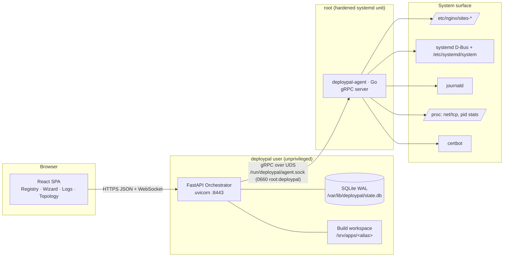
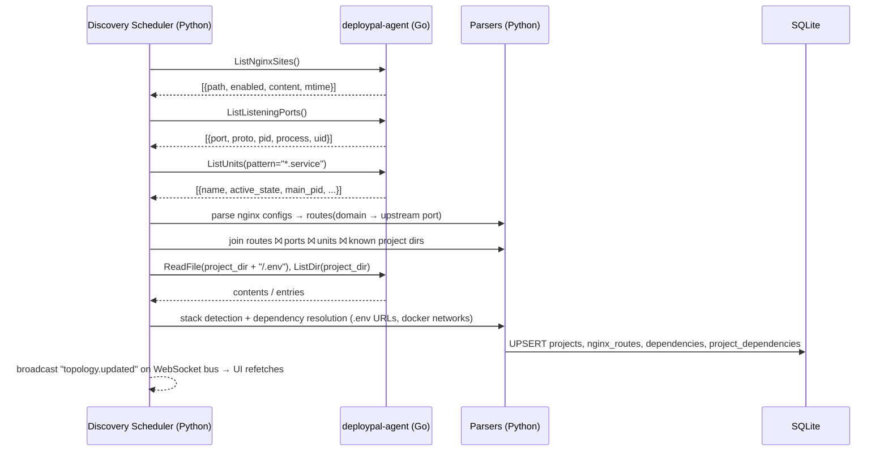
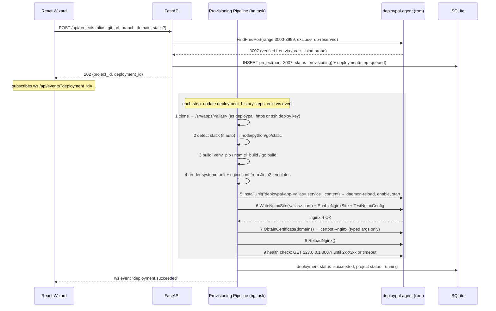

# DeployPal — System Architecture

## 1. Why Go for the agent (and not Rust)

Both work. Go wins for this specific agent:

* **journald + systemd are the hard integrations.** systemd control uses
  `github.com/coreos/go-systemd/v22/dbus` (pure Go — it speaks the D-Bus wire protocol
  directly). Journal reading uses a `journalctl -o json --follow` subprocess rather
  than cgo `sdjournal`: identical unit filtering, tail backfill, and `--after-cursor`
  resumption, but the agent stays `CGO_ENABLED=0` — a single static binary with no
  libsystemd linkage, cross-compilable from anywhere (the same trade Vector makes).
  The Rust equivalents for the D-Bus side are fragmented and less maintained.
* The agent is **IO-bound, not CPU-bound** — it multiplexes many concurrent log streams,
  file watchers, and /proc scans. Goroutines + channels map onto that one-to-one;
  Rust's async gives no practical advantage here and costs development velocity.
* gRPC server tooling (`google.golang.org/grpc`) over a UDS listener is boringly solid.
* Ships as a single static binary (~10 MB, ~20 MB RSS). Rust would save ~10 MB of RAM;
  irrelevant for a host controller.

Rust would be the right call if the agent did heavy log parsing itself — but by design
it doesn't (see §3: the agent moves bytes, Python assigns meaning).

## 2. Component topology



**Privilege model.** The agent is the only root process. Its gRPC surface is a fixed
menu of typed operations — there is deliberately **no `RunCommand` RPC**. Every
mutating RPC validates its inputs against allow-lists (unit names must match
`deploypal-app-[a-z0-9-]+`, nginx writes only under `sites-available/`, certbot only with
fixed argument templates). The UDS is `0660 root:deploypal` and the server additionally
verifies the peer UID via `SO_PEERCRED` on every connection, so a compromised
orchestrator can misuse the menu but cannot escape it, and no other user can talk to
the agent at all.

**Division of labor.** The agent returns *raw facts* (file contents, socket tables,
journal lines, unit states). The orchestrator owns *interpretation* (parsing Nginx
configs, classifying log levels, resolving dependencies) and *state* (SQLite). This
keeps the privileged codebase small and auditable, and lets all the interesting logic
live where it's easiest to test.

## 3. Data flow A — Auto-Discovery & Topology

Discovery is a periodic sweep (default every 60 s, plus on-demand from the UI and
event-driven via the agent's file watcher on `/etc/nginx/sites-enabled/`).



The join logic that turns raw facts into topology:

1. **Nginx reverse map** — parse each server block: `server_name` → domains,
   `listen` → edge ports/TLS, `proxy_pass http://127.0.0.1:PORT` → upstream port.
2. **Port → process** — `/proc/net/tcp{,6}` gives `port → socket inode`;
   scanning `/proc/<pid>/fd/*` inverts that to `inode → pid`; `/proc/<pid>/cwd` and
   `cmdline` give the working directory and command.
3. **Process → project** — a process whose cwd (or systemd `WorkingDirectory`) sits
   under a known app root becomes that project's runtime; its systemd unit (from
   `/proc/<pid>/cgroup`) becomes the project's unit.
4. **Project → dependencies** — `.env` / `.env.production` are scanned for
   `DATABASE_URL`, `REDIS_URL`, `MONGO_URI`, discrete `PGHOST/PGPORT` style vars,
   and `docker-compose.yml` service links. Each resolved endpoint is matched against
   discovered listening services (postgres on 5432, redis on 6379, …) to build the
   M-N `project_dependencies` edge set — which the UI renders as the global
   dependency graph ("postgres@5432 ← api-server, billing-worker").

Discovered-but-unmanaged apps get `projects.origin = 'discovered'`; the user can
"adopt" them from the UI, which fills in alias/repo metadata without touching the
system.

## 4. Data flow B — Provisioning a new service

The wizard collects: alias, git URL, branch, stack (or auto), domain, env vars.
`POST /api/projects` validates, reserves a port, writes the project row
(`status=provisioning`), creates a `deployment_history` row, and hands off to a
background pipeline. The UI follows progress live over the WebSocket event bus.



**Failure handling.** Every step records `{name, status, started_at, finished_at,
log}` into `deployment_history.steps` (JSON). On failure the pipeline runs the
inverse of completed steps in reverse order (disable site → remove unit → release
port → keep the cloned tree for debugging), sets `status=failed`, and surfaces the
failing step's captured output in the UI. Re-deploys of an existing project skip
provisioning steps that are already in place (unit exists, cert valid) — the step
machine is idempotent by construction.

**Port allocation without races.** Free port = (not in `projects.port` DB
reservations) ∧ (not listening per `/proc/net/tcp`) ∧ (agent can transiently
`bind()` it). The DB reservation happens inside the same transaction that inserts
the project row, so two concurrent wizards can't get the same port; the bind probe
catches out-of-band squatters.

## 5. Data flow C — Log streaming & analysis

```
journald ──sdjournal follow──▶ agent StreamLogs (gRPC server-stream, cursor-resumable)
        ──▶ Python relay: level classifier + pattern fingerprinter (per-connection)
        ──▶ WebSocket /api/projects/{id}/logs ──▶ React virtualized LogViewer
```

* The agent filters by `_SYSTEMD_UNIT` at the journald layer (cheap, indexed) and
  supports `tail_lines` backfill plus resume-from-cursor after reconnects.
* Python enriches each line: **level detection** (journald `PRIORITY` field when
  present, else regex on `ERROR|WARN|INFO|DEBUG|panic|Traceback`), and **pattern
  grouping**: the line is fingerprinted by masking volatile tokens (numbers, hex,
  UUIDs, IPs, quoted strings) → identical fingerprints within a sliding window are
  collapsed into one frame with a repeat counter, so 500 identical connection-timeout
  lines render as one row with `×500` instead of flooding the UI.
* Backpressure: if the WebSocket consumer lags, the relay drops to sampled mode
  (keeps all ERROR/WARN, samples INFO/DEBUG) rather than buffering unboundedly.

## 6. Lifecycle & resource monitoring

* **Process control** — UI buttons map to `POST /api/projects/{id}/action
  {start|stop|restart}` → agent `UnitAction` (systemd D-Bus with result wait).
  Dependencies (postgres.service, redis-server.service) are controllable through the
  same path, gated by a confirmation listing the projects that depend on them.
* **Resource monitoring** — the agent samples each managed unit's cgroup
  (`memory.current`, `cpu.stat`) and the project dir's disk usage every 5 s and
  streams `ResourceSample`s; Python keeps a ring buffer in `resource_samples`
  (pruned to 24 h) that feeds the sparkline charts.

## 7. Data flow D — Service catalog (recipe-driven package installs)

The Services page installs infrastructure services (PostgreSQL, Redis,
MySQL/MariaDB, RabbitMQ) and common admin tools from a **recipe catalog the
agent owns**. This preserves the no-`RunCommand` rule: the orchestrator can
only name a `recipe_id` and pass typed params — every package name, apt
argument, config path, and template comes from a recipe root shipped or
approved.

* **Catalog sources.** Builtin recipes are `go:embed`ded in the agent binary —
  *upgrading DeployPal upgrades the catalog automatically*, there is no
  separate distribution step. `/etc/deploypal/recipes/*.yaml` (root-owned) is
  an overlay merged in — and re-read — on every `ListServiceRecipes` call, so
  an admin can add or override a recipe without restarting anything. The
  orchestrator never caches the catalog; `GET /api/services` always reflects
  the agent's current state, and `catalog_version` (a content hash) changes on
  every upgrade or overlay edit.
* **Typed params, computed defaults.** Each recipe declares a param schema
  (enum/int/port/string/secret with ranges). Defaults like Postgres
  `shared_buffers` or Redis `maxmemory` are *derived from host facts* (RAM) at
  list time, shown in the UI with their derivation, and overridable. Bind
  addresses default to localhost.
* **Additive config only.** Recipes write a `# managed-by: deploypal` drop-in
  (`conf.d`) or an included file plus a marker-guarded `include` line — never
  the distro's main config. Removing the service restores stock behavior.
* **Sandbox escape by design.** The agent unit runs `ProtectSystem=strict`,
  so mutating recipe operations (apt, config writes) execute in transient
  units via `systemd-run --wait --pipe`: PID 1 spawns them outside the
  agent's read-only mount namespace while argv stays fully recipe-controlled.
  One apt transaction at a time (dpkg holds a global lock); progress streams
  over the `InstallService` server-stream into the same step-timeline UI as
  deployments, recorded in `dependency_installs`.
* **Registry integration.** A successful install upserts `dependencies`
  (`origin='installed'`, `recipe_id`, managed config path) so the service
  appears in topology immediately, and the systemd action allow-list is
  derived from catalog units — an installed service is start/stop/restart-able
  from the dashboard with zero extra configuration. Removal is an explicit
  user action (with a consumer check), never an automatic rollback.
* **Secrets.** Generated credentials are written to
  `/etc/deploypal/secrets/<recipe>.env` (0600 root) and surfaced to the UI
  exactly once; they are never persisted in SQLite or the event feed.

## 8. Deployment of DeployPal itself

Two systemd units, installed by a bootstrap script:

* `deploypal-agent.service` — root, but hardened: `ProtectHome=yes`,
  `PrivateTmp=yes`, `NoNewPrivileges=yes`, `ReadWritePaths=/etc/nginx /etc/systemd/system /run/deploypal /etc/letsencrypt`,
  `RuntimeDirectory=deploypal` (creates the socket dir).
* `deploypal.service` — `User=deploypal`, `StateDirectory=deploypal` (owns the DB),
  runs uvicorn; serves the built React bundle and the JSON/WS API. Session auth with
  argon2-hashed local users; the API listens on localhost by default and is exposed
  via its own Nginx vhost like any other app it manages.
